# Factory World 3D (Roblox)

Wersja gry Factory World dla Robloxa, w 3D. To osobna gra napisana od zera w Luau: zasady, ceny, przepisy i czasy
są przeniesione z serwera gry 2D (branch `main`, katalog `server/`), a modele 3D są zbudowane w kodzie z części Robloxa.
Branch `roblox-3d` ma własną historię i zawiera tylko wersję Roblox: nie dzieli plików z grą 2D i nie jest scalany z `main`.

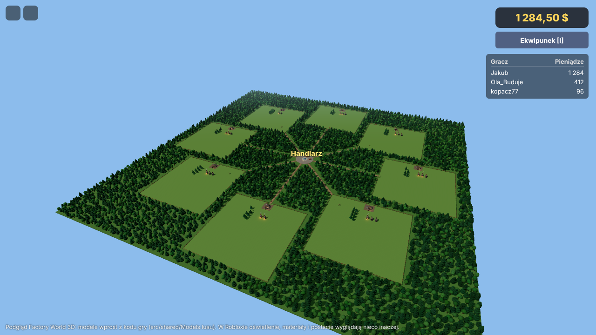
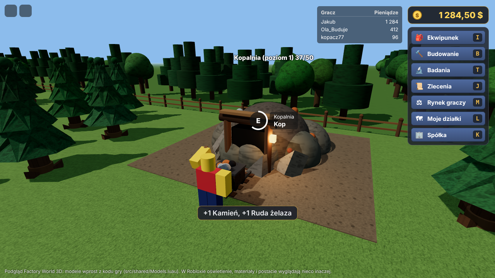
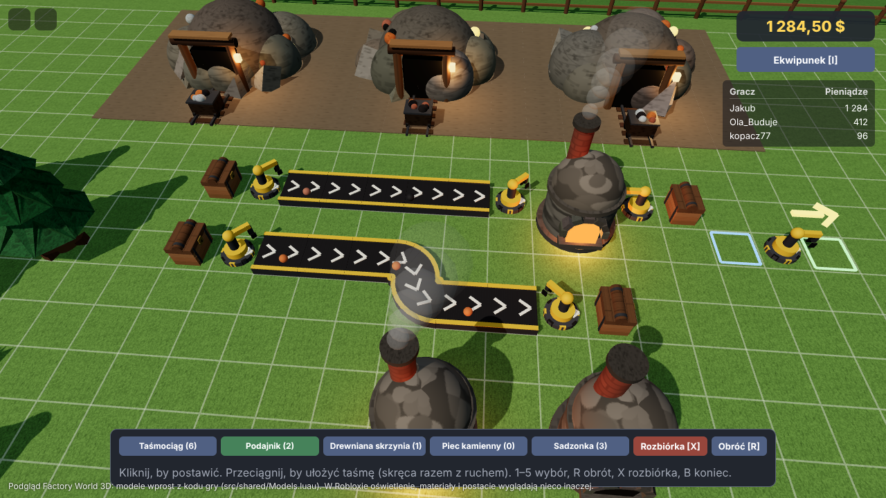
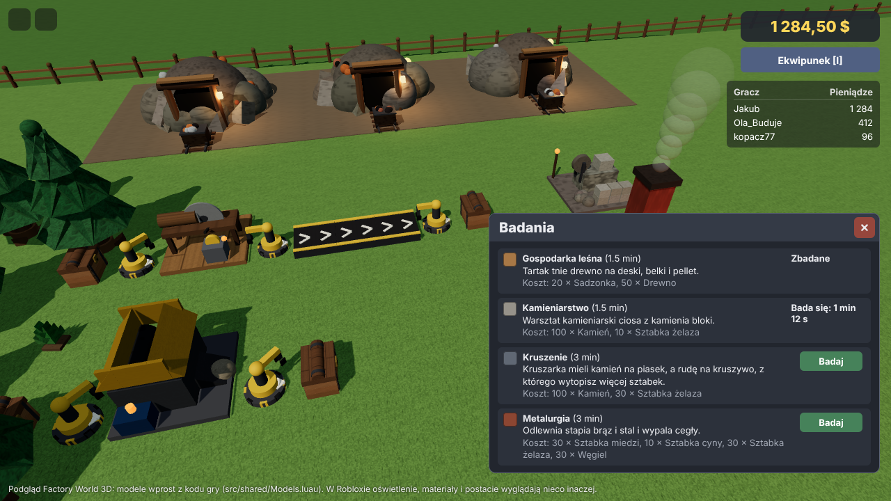
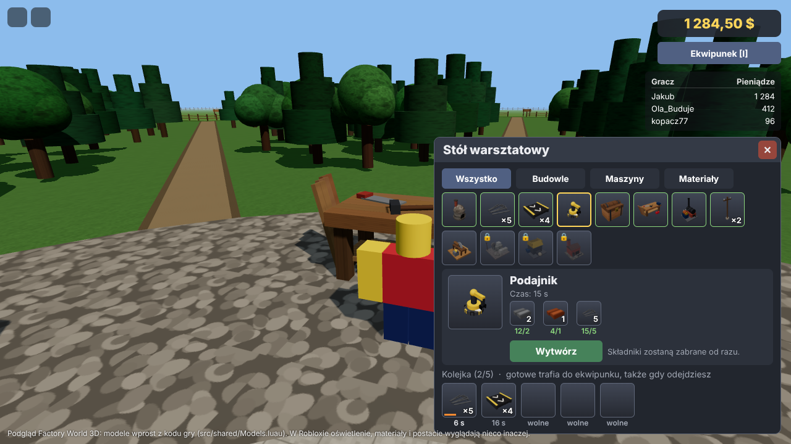
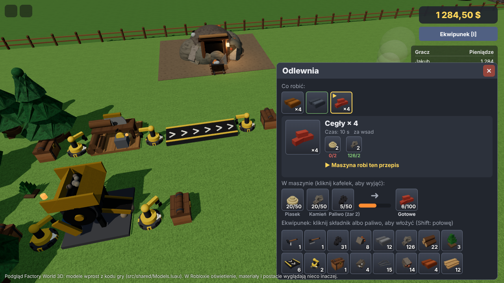
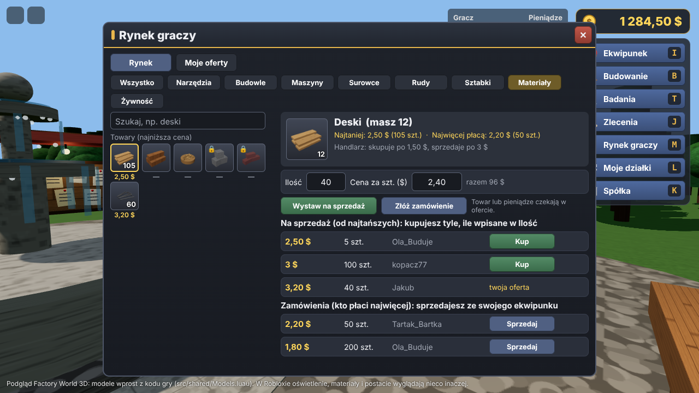
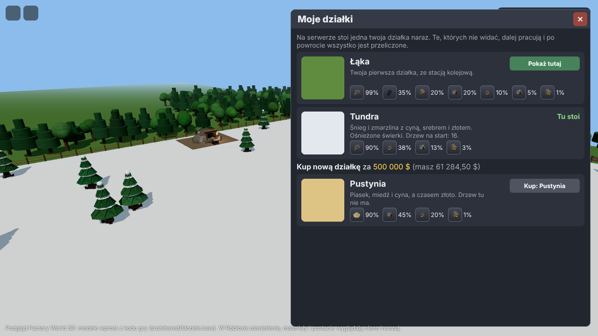
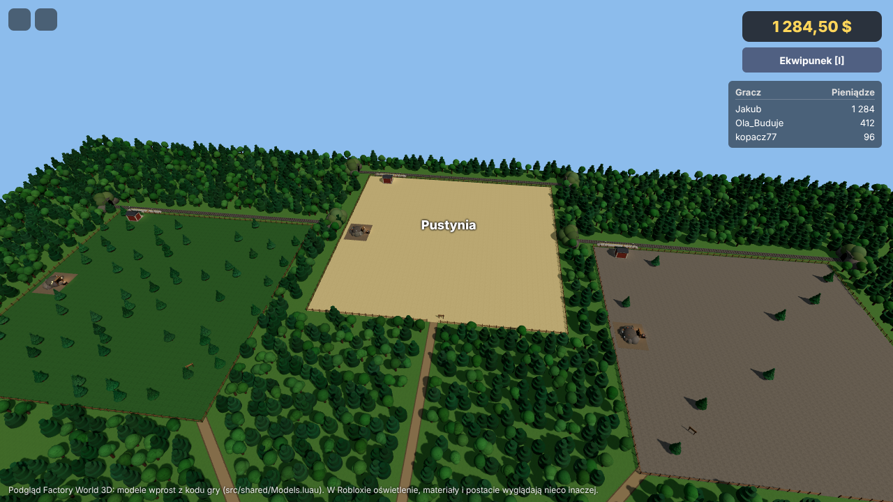
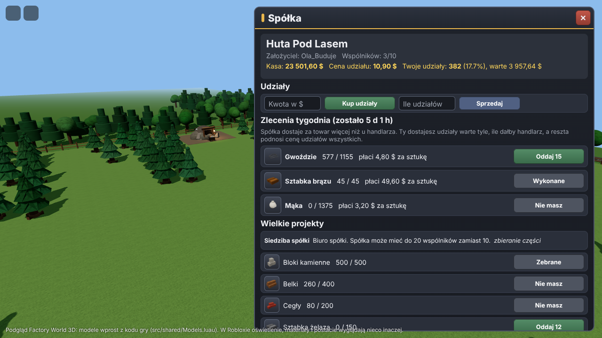
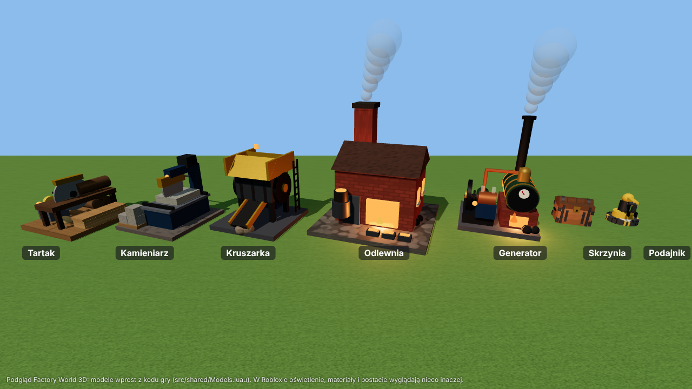
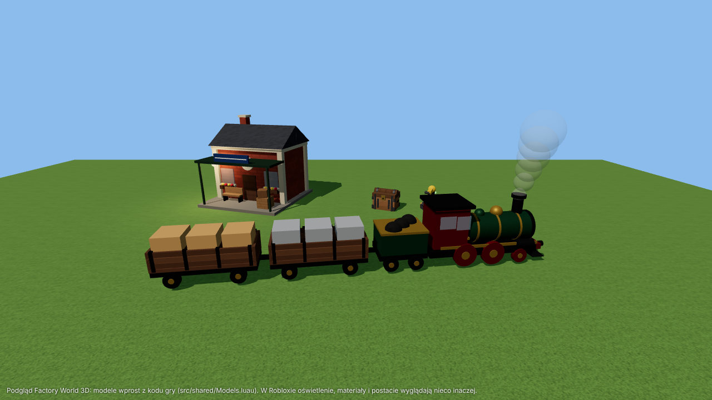
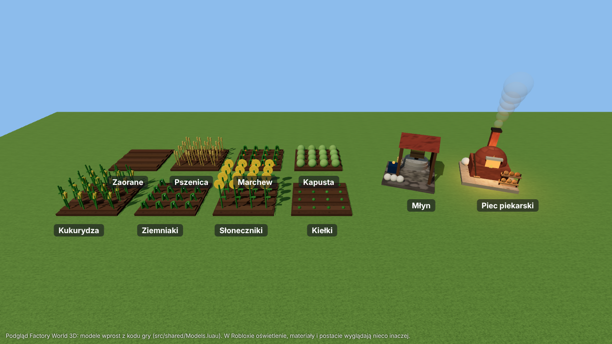
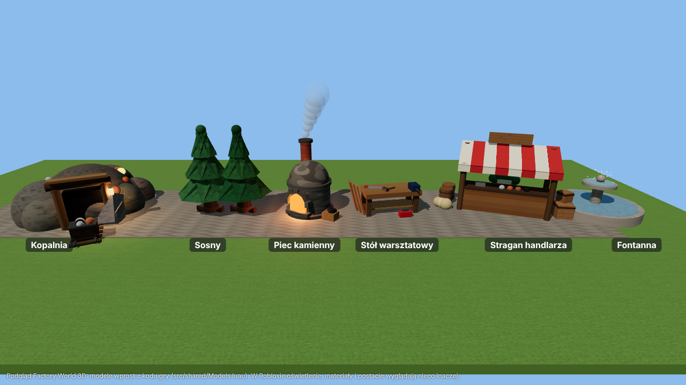

Zrzuty pochodzą z podglądu w przeglądarce (`tools/preview/`), który rysuje dokładnie te modele, które buduje serwer
(`src/shared/Models.luau`); w Robloxie oświetlenie, materiały i postacie wyglądają nieco inaczej.

## Etapy

| Etap | Zawartość | Stan |
| --- | --- | --- |
| 1. Rdzeń | Plac z handlarzem i stołem warsztatowym, działka 3D dla każdego gracza (8 na serwer), jedna kopalnia na działkę z poziomem (na razie 1, pod przyszłe ulepszenia; kilof, 5 s, do 2 rud, 50 urobków, 10 min na odnowienie), 8 dzikich sosen (siekiera, 5 s, 1 drewno), piec kamienny (węgiel, 5 wytopów z jednej bryłki, liczy się sam, gdy gracza nie ma), stół warsztatowy (piec z 20 kamieni, gwoździe), ekwipunek, portfel w centach z księgą operacji, zapis postępu w DataStore | gotowe |
| 2. Logistyka | Działka 232 × 232 study z siatką budowania na całości (56 × 56 pól po 4 study; wszystko na działce stoi na jej polach), tryb budowania (stawianie, obracanie, rozbiórka, linie siatki widoczne tylko przy budowaniu), taśmociągi (2 pasy, zakręty, dołączanie z boku, przeciąganie skręca taśmę), podajniki, drewniane skrzynie (8 miejsc po 100 szt.), piec na siatce karmiony podajnikami, drzewa jak w 2D (ścięte znika, 30% na sadzonkę, sadzonka rośnie 10 min), nowe przepisy na stole (taśmociąg ×4, podajnik, skrzynia), gęsty las między działkami i wokół placu (tylko ozdoba, nie da się go ściąć ani w nim budować; ścieżki do bram wolne) | gotowe |
| 3. Przetwórstwo | Maszyny na siatce (2 × 2 pola, odlewnia 3 × 3) z przepisami i czasami z gry 2D: tartak (deski, belki, pellet), warsztat kamieniarski (bloki), kruszarka (piasek, kruszywo rud: 3 z 2 rud, w piecu topi się szybciej), odlewnia na węgiel, drewno albo pellet (brąz, stal, cegły); maszyna robi wsad za wsadem także pod nieobecność gracza, podajniki ją karmią i opróżniają. Badania (jedno naraz, koszt od razu, czas jak w 2D): Gospodarka leśna, Kamieniarstwo, Kruszenie, Metalurgia odblokowują maszyny na stole i u handlarza. Od etapu 5 kruszarka potrzebuje prądu | gotowe |
| 4. Handel | Rynek graczy na wszystkich serwerach (**M**): oferty sprzedaży i zamówienia jak w 2D (towar albo pieniądze czekają w ofercie, inni biorą część albo całość, zarobek przychodzi sam także pod nieobecność; do 20 ofert każdego rodzaju, do 10 000 szt. i 1 000 000 $ za sztukę, rzeczy niezbadane można tylko sprzedawać). Wydarzenia rynkowe u handlarza co 6 godzin (Boom na stal, Boom budowlany, Sroga zima, Gorączka miedzi, Moda na brąz, Gorączka złota, Zalew kamienia, Wyprzedaż maszyn), takie same na każdym serwerze, oraz codzienne wahania cen skupu do 10%; handlarz zawsze płaci najwyżej 90% swojej ceny sprzedaży | gotowe |
| 5. Świat | **Prąd (gotowe):** generator parowy 2 × 2 (100 kW, węgiel 200 s, drewno 50 s, pellet 40 s przy pełnej mocy, do 50 sztuk; paliwo wkłada się w jego oknie albo podajnikiem), słupy energetyczne (zasilają pola 5 × 5 wokół siebie, łączą się kablem ze słupami do 7 pól dalej w jedną sieć), kruszarka pobiera 40 kW; przy za małej mocy wszystkie maszyny sieci pracują wolniej, bez prądu stoją i pamiętają postęp wsadu. Generator (stół: 10 kamieni, 8 sztabek żelaza, 4 sztabki miedzi) i słupy (×2: 2 drewna, 1 sztabka miedzi). Liczone na żądanie także pod nieobecność gracza. **Pociągi (gotowe):** każda działka ma stację kolejową (3 × 3 pola przy wschodnim płocie, nie da się jej rozebrać) z peronem i torem za płotem, który z obu stron znika w tunelu. Towar ładuje się na stację ręcznie albo podajnikami (do 10 000 szt. jednego towaru), podajniki też ją rozładowują. Wysyłka do innego gracza (szukanie po nazwie, na dowolnym serwerze): opłata 1 $ + 1 ¢ za sztukę na 100 km, czas 5 s na 100 km (najmniej 10 s), jak w 2D; towar czeka na stacji odbiorcy, także gdy go nie ma w grze. Trasy (do 5): pociąg co 1, 5, 15 albo 60 minut z wybranymi towarami albo wszystkim (do 2000 szt.), póki właściciel jest w grze. Pociąg widać, jak przyjeżdża z tunelu, staje przy peronie i odjeżdża. **Stół warsztatowy** jako przedmiot (u handlarza albo z 20 drewna i 5 gwoździ) do postawienia na działce. **Działki z biomami (gotowe, L):** poza pierwszą działką (Łąka) można kupić po jednej działce Las (60 drzew, kopalnia z dużą ilością węgla), Pustynia (bez drzew; piasek, miedź, cyna, czasem złoto), Góry (8 drzew; żelazo, srebro, węgiel) i Tundra (16 ośnieżonych świerków; cyna, srebro, złoto). Biom wybiera się przy zakupie, a działki kosztują 50 000 $, 500 000 $, 5 000 000 $ i każda następna 1 000 000 000 $. Na serwerze gracz ma jedno miejsce na działkę: w oknie *Moje działki* wybiera, którą tam pokazać, a gra buduje ją w tym samym miejscu z jej ziemią, kopalnią, siatką, piecami i maszynami. Działki, których nie widać, liczą się dalej i po powrocie wszystko jest nadrobione. **Pociągi między własnymi działkami (gotowe):** każda działka ma swoją stację z torem. W oknie stacji na liście „Komu” są najpierw twoje inne działki: pociąg jedzie 20 s i kosztuje tylko 1 $, a towar trafia na stację tamtej działki, także gdy jej nie widać. Trasy działają tak samo (np. ruda z Gór co 5 minut na Łąkę) i ruszają ze stacji działki, na której je dodano; działka, której nie widać, jest przed odjazdem przeliczona do teraz. Pociągi od innych graczy przyjeżdżają na stację Łąki. Odległości pociągów nadal liczą się w wymyślonym świecie 2400 × 1200 km. **Spółki (gotowe, K):** gracze z dowolnych serwerów zakładają spółkę (10 000 $, które trafiają do jej kasy; założyciel dostaje 1000 udziałów) albo dołączają do istniejącej (do 10 wspólników, nazwa unikalna i sprawdzona filtrem Robloxa). Udziały kupuje się po cenie udziału (kasa ÷ udziały, najmniej 1 $) i sprzedaje spółce za 95% tej ceny. Co tydzień spółka ma 3 zlecenia na towar (zawsze takie same dla danej spółki i tygodnia); towar z ekwipunku płaci 160% ceny handlarza do kasy, a oddający dostaje udziały warte tyle, ile dałby handlarz, więc reszta podnosi cenę udziałów wszystkich. Założyciel raz dziennie wypłaca dywidendę (20% kasy według udziałów), może usuwać wspólników (ich udziały są odkupione) i zamyka spółkę, odchodząc jako ostatni. Dywidendy przychodzą same, także po powrocie do gry. Odejście i usuwanie wspólnika trzeba potwierdzić drugim kliknięciem. **Wielkie projekty** (jak w 2D): założyciel zaczyna projekt, wspólnicy znoszą części z ekwipunku, a po zebraniu wszystkich spółka buduje go przez 24 albo 48 h; *Siedziba spółki* (500 bloków kamiennych, 400 belek, 200 cegieł, 150 sztabek żelaza) pozwala mieć 20 wspólników, *Magazyn spółki* (po siedzibie) daje 5 zleceń tygodniowo zamiast 3, a *Kolej spółki* (po siedzibie) obniża o 30% opłatę za odległość pociągów między wspólnikami. Wspólnicy są na liście „Komu” w oknie stacji od razu. **Lepsze modele (pierwsza tura):** nowa kruszarka (stalowa obudowa na nogach, koła zamachowe, walce w leju, taśma wysypująca kruszywo, drabinka), nowy warsztat kamieniarski (piła tarczowa na wysięgniku nad stołem z płytą, zbiornik wody, paleta bloków) i nowy generator (kocioł z kopułą, manometrem i zaworem, maszyna parowa z kołem zamachowym napędzającym prądnicę), a tartak i odlewnia mają więcej szczegółów. **Druga tura:** nowy parowóz (zielony kocioł z mosiężnymi obręczami i kopułami, duże koła napędowe, zderzaki i zgarniacz, kabina z oknami, tender z węglem) i wagony z deskami i kłonicami; stacja z kominem, skrzynkami kwiatów, ławką i tablicą; skrzynia z okuciami i uchwytami; podajnik z siłownikiem i lampką. **Trzecia tura:** stół warsztatowy z tablicą narzędzi, półką ze słoikami i lampą; fontanna z drugą czaszą, strugami wody, liliami i kamiennymi rybami; wszystko nadal z części w `Models.luau`, bez wgrywania assetów | w toku |
| 6. Rolnictwo | **Motyka** (u handlarza za 100 $ albo ze stołu: 2 sztabki żelaza, 2 drewna) zaorze pole 2 × 2 na siatce działki; motyka zostaje w ekwipunku. Pola da się zakładać na Łące i w Lesie, na pustyni, w górach i w tundrze ziemia nie urodzi. Na pustym polu „Zasiej” otwiera okno z sześcioma uprawami (nasiona za darmo): pszenica (5 min, 8 szt.), marchew (7 min, 8), kapusta (8 min, 4), kukurydza (10 min, 6), ziemniaki (15 min, 10) i słoneczniki (20 min, 6). Uprawa rośnie sama, także pod nieobecność gracza, widać kiełki, połowę wzrostu i dojrzałe rośliny; dojrzałe zbiera się przytrzymaniem E, a pole zostaje zaorane. Zabranie pola narzędziem do zbierania oddaje ziemię trawie (dojrzałe plony trafiają do ekwipunku). **Młyn** (badanie *Młynarstwo*; prąd 30 kW) miele 2 pszenicy na mąkę i 2 kukurydzy na mąkę kukurydzianą, **piec piekarski** (badanie *Piekarnictwo*, opalany jak odlewnia) piecze z 2 mąk chleb albo chleb kukurydziany; oba 2 × 2, obsługiwane podajnikami. Nowa kategoria *Żywność* u handlarza | gotowe w kodzie, nie sprawdzone w Studio |

## Uruchomienie w Roblox Studio

Potrzebne: konto Roblox, [Roblox Studio](https://create.roblox.com/) i [Rokit](https://github.com/rojo-rbx/rokit) (instaluje Rojo).

1. W głównym katalogu repozytorium (na branchu `roblox-3d`): `rokit install`, potem `rojo serve`.
2. W Studio zainstaluj wtyczkę Rojo (*Plugins → Manage Plugins* albo `rojo plugin install`), utwórz nowe miejsce (*Baseplate*),
   usuń z niego `Baseplate` i w panelu Rojo kliknij *Connect*. Kod pojawi się w `ReplicatedStorage`, `ServerScriptService` i `StarterPlayer`.
3. *Play* (F5). Bez publikacji gra działa, ale postęp nie zapisuje się (w oknie Output pojawi się ostrzeżenie `[Data]`).
4. Zapis postępu: opublikuj miejsce (*File → Publish to Roblox*) i włącz *Game Settings → Security → Enable Studio Access to API Services*.
5. W *Game Settings → Places* ustaw maksymalnie 8 graczy na serwer (tyle jest działek).
6. Test wielu graczy: *Test → Clients and Servers → 2 Players → Start*.
7. Rynek graczy działa między serwerami tylko w opublikowanej grze (DataStore). W Studio bez dostępu do API działa w obrębie jednego serwera testowego, więc dwóch graczy z punktu 6 może handlować ze sobą.

Zbudowanie pliku miejsca bez Studio: `rojo build -o FactoryWorld3D.rbxl`.

## Sterowanie

Chodzenie jak w każdej grze Roblox. **E** (przytrzymaj) przy kopalni kopie, przy drzewie ścina, przy handlarzu, stole i piecu otwiera okno.
**I** otwiera ekwipunek: kratka 20 pól jak w grze 2D (przeciągnij, aby przenieść). W oknach skrzyni, pieca i maszyny kliknięcie pola w kratce ekwipunku wkłada cały stos (Shift: połowę), a kliknięcie pola skrzyni go wyjmuje. Stół warsztatowy i maszyny pokazują przepisy jako kafelki z ikonami 3D (zakładki na stole, złota ramka = wybrany, zielona = masz składniki, kłódka = wymaga badań). Karta przepisu pokazuje składniki z liczbą „masz/potrzeba” (brakujące na czerwono) i przycisk „Wytwórz” albo „Ustaw przepis”. To, co jest w piecu i maszynie, widać jako kafelki z paskiem postępu; kliknięcie kafelka wyjmuje zawartość. Handlarz i rynek graczy dzielą towary na zakładki (Narzędzia, Budowle, Maszyny, Surowce, Rudy, Sztabki, Materiały), a rynek ma też pole *Szukaj*. Handlarz pokazuje towary jako kafelki z ceną (zielona = lepsza niż zwykle, czerwona = gorsza), a u góry trwające albo następne wydarzenie rynkowe. **M** (albo przycisk *Rynek graczy*) otwiera rynek graczy: po lewej towary z najniższą ceną, po prawej oferty wybranego towaru (*Kup*, *Sprzedaj*) i formularz *Ilość* + *Cena za szt.* z przyciskami *Wystaw na sprzedaż* i *Złóż zamówienie*; zakładka *Moje oferty* pozwala je anulować (reszta wraca). **L** (albo przycisk *Moje działki*) otwiera listę działek: *Pokaż tutaj* zamienia działkę na serwerze, a niżej można kupić nową z wybranym biomem. **K** (albo przycisk *Spółka*) otwiera spółkę: bez spółki listę spółek do dołączenia i formularz założenia, w spółce kasę, cenę i twoje udziały (*Kup udziały*, *Sprzedaj*), zlecenia tygodnia z przyciskiem *Oddaj*, wspólników i ostatnie zdarzenia. **Esc** zamyka okno. Nowy gracz dostaje kilof, siekierę i 50 $. Zwykłe ceny skupu i sprzedaży są takie jak w grze 2D.

**B** (albo przycisk *Budowanie*) włącza tryb budowania na siatce działki: **1–9** wybiera taśmociąg, podajnik,
skrzynię, piec, sadzonkę albo maszynę (maszyny widać na pasku, gdy ma się którąś w ekwipunku), **R** obraca, kliknięcie stawia (przeciągnięcie układa taśmę, która skręca razem z ruchem),
**X** to rozbiórka (kliknięta rzecz wraca do ekwipunku razem z zawartością). Drzewa ścina się siekierą (przytrzymaj **E**). Podajnik bierze z pola za sobą (taśma, skrzynia, sztabki z pieca) i kładzie na
pole przed sobą. Skrzynię, piec i maszynę otwiera **E**; w oknie maszyny wybiera się, co ma robić, i wkłada składniki.
Stację kolejową otwiera **E**: zakładki *Magazyn* (kliknięcie towaru wyjmuje go do ekwipunku, kliknięcie w ekwipunku ładuje na stację), *Wyślij* (wpisz nazwę gracza, *Szukaj*, wybierz go i towar, ilość, *Wyślij pociągiem*) i *Trasy*.
Generator otwiera **E**: pokazuje paliwo, moc i stan sieci; okno kruszarki mówi, czy ma prąd.
**T** (albo przycisk *Badania*) otwiera badania. W Studio badania trwają najwyżej 10 s, żeby szybciej testować.

## Jak to jest zbudowane

| Miejsce | Zawartość |
| --- | --- |
| `src/shared/` (`ReplicatedStorage.Shared`) | Czyste zasady gry bez API Robloxa: `Items` (id jak w `Contracts/Items.cs`, nazwy, kolory), `Prices`, `Mining`, `Forestry`, `Smelting`, `Processing` (maszyny przetwórcze, jak `Processing.cs`), `Research` (drzewko badań, jak `Research.cs`), `Rail` (stacje, wysyłki i trasy kolei, jak `Railway.cs`), `WorldMap` (wymyślony świat, w którym stoją stacje), `Lands` (działki z biomami: ceny, kopalnie, drzewa, zamiana działek), `Companies` (spółki: udziały, zlecenia, dywidendy, jak `Companies.cs`), `Power` (generatory, słupy i sieci prądu, jak `PowerRules` w `Grid.cs`), `Market` (księga ofert rynku graczy, jak `PlayerMarket.cs`), `MarketEvents` (wydarzenia i wahania cen handlarza, jak `MarketEvents.cs`), `Workshop`, `Logistics` (siatka, taśmy, podajniki, skrzynie, porty maszyn, jak `Simulation.cs`), `PlotLayout`, `Money`, `Remotes`, `Assemble` (składa model z części, dla serwera i ducha budowania u klienta), a także `Models`: każdy obiekt (kopalnia, sosna, piec, maszyny, stół, stragan, handlarz, fontanna, płot, ozdoby działki) jako lista części z kształtem (kula, walec, klin, prostopadłościan), materiałem, kolorem i efektami (ogień, dym, światło) |
| `src/server/` (`ServerScriptService.Server`) | `Main` uruchamia usługi z `Services/`: `Data` (DataStore z blokadą sesji i autozapisem), `Wallet`, `Inventory`, `Net` (zdalne wywołania, limit 20 na sekundę, sprawdzanie danych), `World` (plac i las), `Plots` (działki, kopanie, kupno i zamiana działek), `Furnaces`, `Factory` (liczy siatkę do teraz), `Grid` (budowanie, ścinanie i sadzenie drzew, skrzynie, stan taśm i ramion dla klienta), `Machines` (okno maszyny), `Generators` (okno generatora), `Railway` (stacja, pociągi między graczami przez DataStore z tym samym zabezpieczeniem co rynek), `Companies` (spółki w DataStore: katalog nazw i jeden klucz na spółkę, z tym samym zabezpieczeniem), `Lab` (badania), `Merchant` (ceny z wydarzeniami), `PlayerMarket` (rynek graczy: księgi ofert w DataStore zmieniane przez `UpdateAsync`, transakcje zapisane w profilu jako oczekujące i rozliczane po powrocie gracza, gdy serwer padnie w połowie), `Workshop`, `Build` (zamienia `Models` w części Robloxa) |
| `src/client/` (`StarterPlayerScripts.Client`) | `Main`, `Game` (stan gracza, wywołania serwera, polskie teksty błędów), `GridView` (płynny ruch taśm i ramion podajników, kręcące się piły i walce maszyn), `Ui/` (HUD, `ItemGrid` (kratka przedmiotów z ikonami 3D), `Recipes` (zakładki, kafelki przepisów, karta przepisu), ekwipunek, handlarz, piec, stół, skrzynia, maszyna, badania, pasek budowania) |
| `tests/` | Testy zasad z `src/shared` i sprawdzenie składni wszystkich plików: `npm install`, potem `npm test` (Lua 5.3 w Node, bez Robloxa) |
| `tools/preview/` | Podgląd 3D w przeglądarce (three.js): `scene.js` uruchamia `Models.luau` i `PlotLayout.luau` w Node i składa z nich plac i działki tak jak serwer, a potem robi zrzuty do `docs/screenshots` (`npm run preview`, wymaga Chromium z Playwright) |

Zasady z gry 2D obowiązują też tutaj:

- **Serwer decyduje o wszystkim.** Klient wysyła tylko intencje (`ReplicatedStorage.Remotes`). Serwer sprawdza zakres liczb, własność pieca i działki,
  odległość gracza, czas przytrzymania przycisku i posiadane narzędzie, a dropy losuje sam (`Random` serwera podany do czystej funkcji).
- **Wszystko albo nic.** Zmiana pieniędzy i przedmiotów w jednej operacji dzieje się bez żadnego `yield` między sprawdzeniem a zmianą, więc żadne inne żądanie nie wejdzie pomiędzy.
- **Pieniądze tylko przez `Wallet`**, w centach, każda zmiana z `reason` w księdze gracza (200 ostatnich wpisów).
- **Id przedmiotów trafiają do DataStore:** nie zmieniaj istniejących id w `src/shared/Items.luau`.
- **Symulacja na żądanie:** piec, kopalnie, drzewa, stół i siatka liczą stan od zapisanego czasu (`Clock.Now()`, czas Unix), gdy ktoś na nie spojrzy.
  Siatka idzie krokami po 0,2 s, najwyżej 30 minut pracy bez przerwy na jedno nadrabianie (jak w grze 2D); póki właściciel jest na serwerze, jest odświeżana co krok tylko po to, żeby było widać ruch.
- **Handlarz zawsze płaci mniej, niż sam bierze** (sprawdza to test).

Kod pisany jest w części Luau zgodnej ze zwykłą Lua (bez adnotacji typów, `continue` i `+=`), żeby testy i sprawdzenie składni działały poza Robloxem.

## Do decyzji

- Pieniądze na start (`Prices.StartingCents`, teraz 50 $) i narzędzia startowe (teraz kilof i siekiera).
- Czy na Robloxie ma być jeden wspólny świat działek (mapa Ziemi z gry 2D), czy działki tylko na czas pobytu na serwerze, jak teraz.
